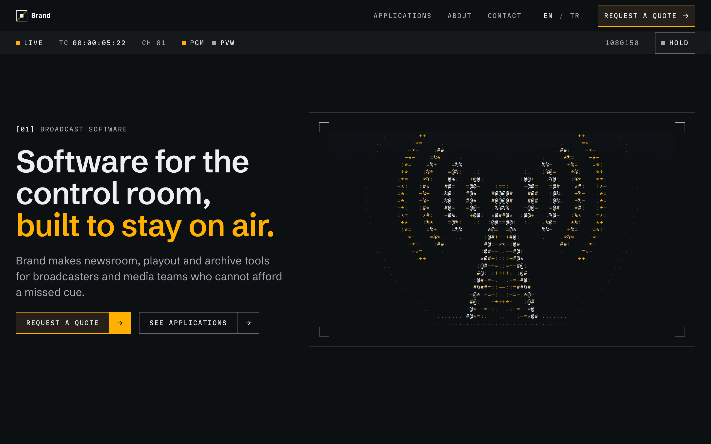
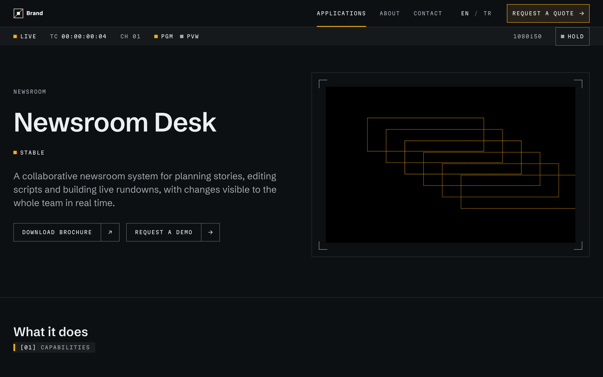
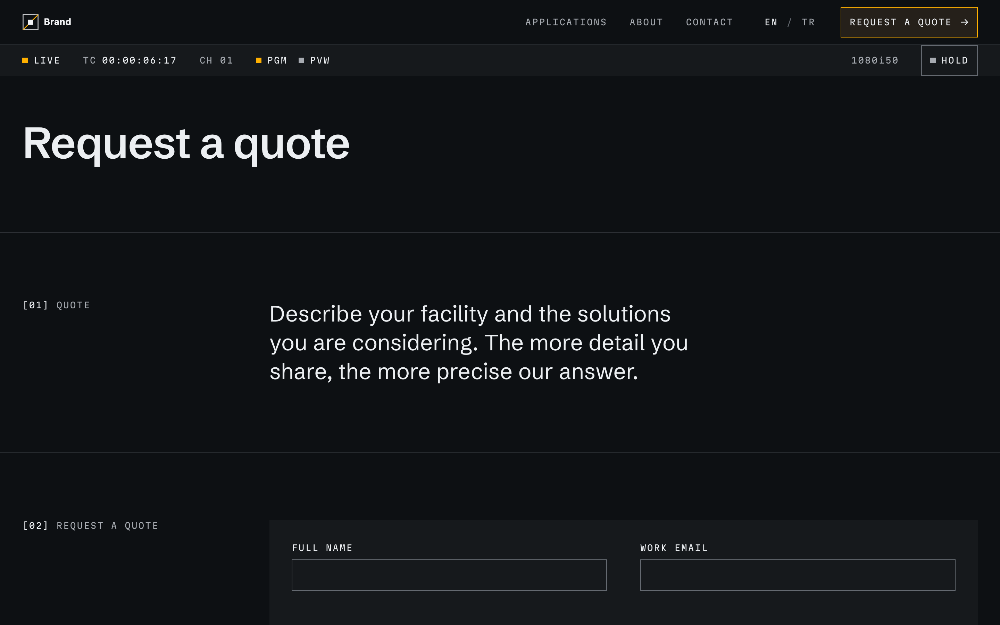
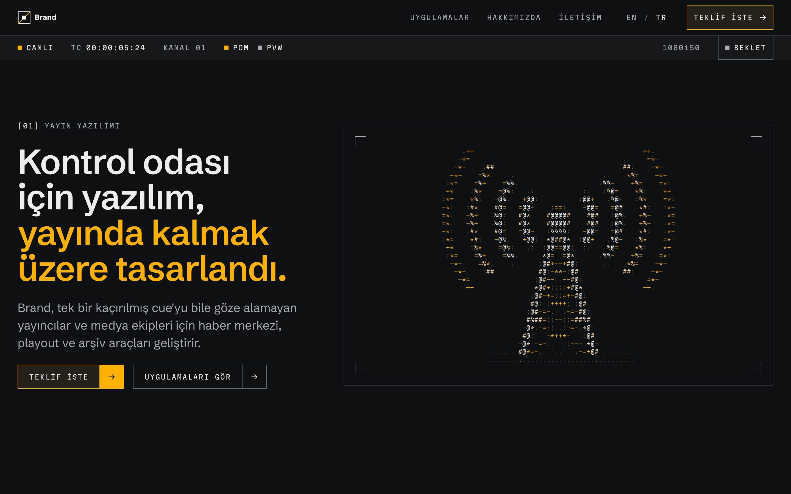
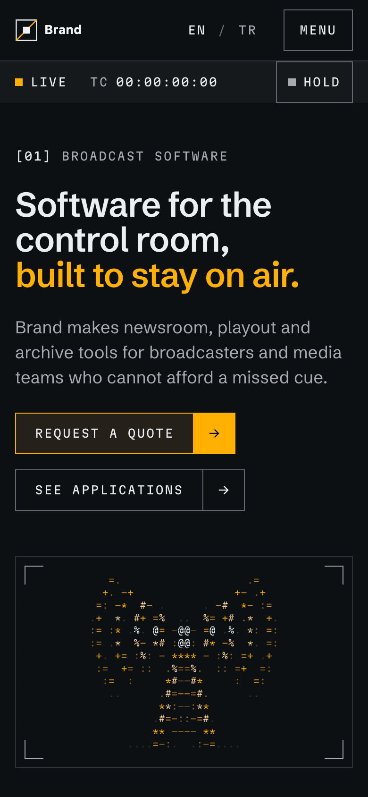

# Corporate Site

[](LICENSE)


A static, brand-agnostic corporate website for broadcast and media technology companies. Brand name, logo, accent colour and contacts come from CMS settings, so the same code serves any company. Content lives in the repository and is edited through a Git-based CMS.



## Who it is for

- Companies that build software or services for broadcasters, newsrooms and media teams and need a calm, credible website.
- Editors who manage pages, applications and translations without touching code.
- Owners who want a free-tier setup: no database, no servers, no visitor accounts.

## Features

- **Two languages.** English at `/`, optional Turkish at `/tr/`. Untranslated entries fall back to English.
- **Block-based pages.** Pages and applications compose seven typed blocks: `hero`, `statement`, `app-grid`, `feature-list`, `rich-text`, `cta`, `faq`.
- **ASCII hero.** The hero image is converted to an animated ASCII broadcast signal at build time. A HOLD key pauses it, and it stays static under reduced motion.
- **Git-based CMS.** Keystatic at `/keystatic/`. Editors save to a branch and open a pull request; an admin reviews the YAML diff and merges.
- **Quote form.** Posts to a Cloudflare Worker that verifies Turnstile and sends the request by Email Routing.
- **Security headers.** Strict CSP and related headers served from `public/_headers`.
- **Near-zero JavaScript.** Native forms, `<dialog>`, Popover API and `<details>` come before scripts.
- **Accessible.** Semantic markup, visible focus, keyboard-operable controls.

## Screenshots

<table>
  <tr>
    <td width="50%"><br><sub>Application page</sub></td>
    <td width="50%"><br><sub>Quote form</sub></td>
  </tr>
  <tr>
    <td width="50%"><br><sub>Turkish home page (<code>/tr/</code>)</sub></td>
    <td width="50%" align="center"><br><sub>Mobile</sub></td>
  </tr>
</table>

## Tech stack

| Technology | Purpose |
|---|---|
| [Astro](https://astro.build) 7 | Static site generation, file-based routing |
| TypeScript 6 (strict) + Zod | Typed content schemas validated at build time |
| Tailwind CSS 4 | Styling with design tokens |
| [Keystatic](https://keystatic.com) | Editing UI at `/keystatic/`, GitHub backend, served by the same Worker |
| Cloudflare Workers Static Assets | Hosting of the built site |
| Cloudflare Worker | `POST /api/quote` endpoint |
| Cloudflare Turnstile | Bot protection for the quote form |
| Cloudflare Email Routing | Delivers quote requests to the owner |
| Cloudflare R2 | Optional storage for large files |
| Biome | Lint and format |
| Node 26 / pnpm 12 | Runtime and package manager |

## Project structure

```
src/
  content/       Typed YAML: pages, applications, navigation, ui strings, settings (EN/TR)
  components/
    ui/          Small primitives (Button, Field, Tally, AsciiImage, ...)
    sections/    The seven blocks and the section renderer
    layout/      Header, footer, mobile nav, language toggle, SEO head
    pages/       Page templates (generic, application, quote, 404)
  lib/           Content loading, i18n, ASCII pipeline, schemas, helpers (with unit tests)
  pages/         Routes: EN at the root, Turkish under tr/, admin, 404, robots
  styles/        Global styles and tokens
worker/          Cloudflare Worker for the quote endpoint
public/          Static files: _headers, favicon, CMS assets
docs/            Runbook, design spec, implementation plan, screenshots
memory-bank/     Project notes: brief, patterns, tech context, progress
```

## Getting started

Prerequisites: Node 26.13.1 (see `.nvmrc`) and pnpm 12.23.0.

```sh
pnpm install
pnpm dev        # Astro dev server
pnpm build      # static build into dist/
pnpm preview    # build, then run the site and Worker locally with wrangler dev
```

Quality checks:

```sh
pnpm test       # unit tests (node --test)
pnpm check      # type check (run after a build)
pnpm lint       # Biome check
pnpm format     # Biome check with fixes
```

`pnpm run deploy` builds and deploys with Wrangler; in normal use Workers Builds does this on every push to `main`. Local secrets go in `.dev.vars` (gitignored); see the runbook.

## Content editing

Open `/keystatic/` and sign in with GitHub. Edit pages, applications, navigation, UI strings or site settings in English and Turkish. Locally, `pnpm dev` serves the same admin in local mode at `/keystatic/`: it needs no GitHub and writes the files directly. `/admin/` redirects to `/keystatic/`.

| Role | Can do |
|---|---|
| Editor (GitHub Write access) | Edit content. A save to the protected `main` is offered as a new branch; open the pull request from it. |
| Admin (Maintain/Admin, code owner) | Review the YAML diff and a local build, then merge to `main`. |

The site rebuilds after the merge. See section 4 of the [runbook](docs/runbook.md#4-editing-flow).

## Deployment

The site is deployed by Cloudflare Workers Builds from the `main` branch: it runs the build and serves `dist/` as static assets, with one Worker handling `/api/quote` and the Keystatic sign-in and API (`/api/keystatic/*`), through a GitHub App you create. Secrets (`TURNSTILE_SECRET_KEY`, `QUOTE_TO`, `QUOTE_FROM`, `KEYSTATIC_GITHUB_CLIENT_ID`, `KEYSTATIC_GITHUB_CLIENT_SECRET`, `KEYSTATIC_SECRET`) are set in Cloudflare and never committed.

Follow the [runbook](docs/runbook.md) for one-time setup and complete its [security checklist](docs/runbook.md#security-checklist-before-the-first-editor) before inviting the first editor.

## Documentation

- [Design spec](docs/superpowers/specs/2026-11-23-corporate-site-design.md)
- [Implementation plan](docs/superpowers/plans/2026-11-23-corporate-site.md)
- [Deploy and setup runbook](docs/runbook.md)
- [Memory bank](memory-bank/) (project brief, patterns, tech context, progress)
- [CLAUDE.md](CLAUDE.md) (conventions for AI-assisted work)

## License

[MIT](LICENSE)
